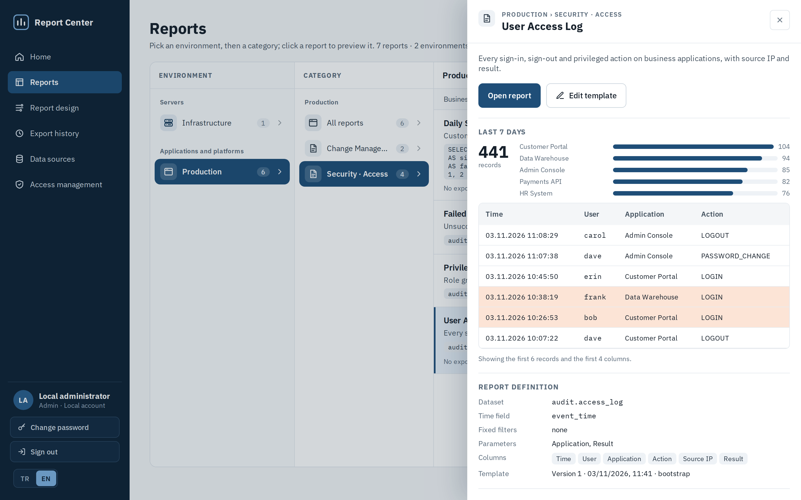
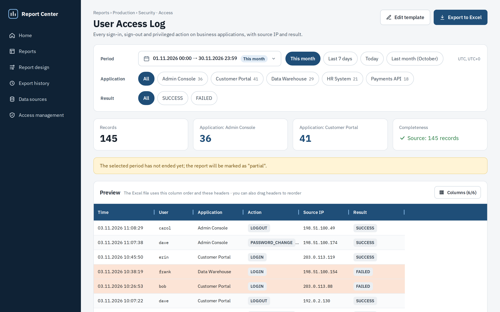
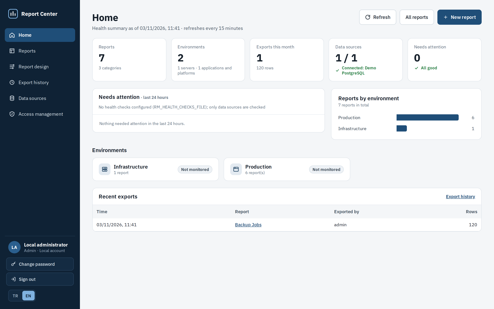

# Report Center

Self-hosted web application that turns data from **Elasticsearch, Prometheus / Thanos, PostgreSQL and SQL Server** into audit-ready Excel reports. Reports are designed once in the browser. Anyone with access then picks a period, previews the rows and exports an Excel file whose integrity can be verified later.

The interface is available in **English and Turkish** (switch in *Settings › General* or on the sign-in page).



| | |
|---|---|
|  |  |

## Features

- **Report browser:** Environment › Category › Report tree with a preview panel. Pick a period and parameters, sort by clicking a column header, preview, export to Excel.
- **Report designer:** columns from the source's real fields with drag-and-drop ordering, fixed filters, user parameters, row highlight rules and Excel notes. Every save creates a new template version.
- **Custom SQL:** on PostgreSQL and SQL Server sources a report can be based on a `SELECT` query instead of a table.
- **Audit-ready Excel:**
  - a report information sheet: period, scope, query, completeness check, data SHA-256, signature fields;
  - a data sheet with real date cells, frozen header and filters.
- **Completeness check:** if the number of rows read does not match the source's count, no file is produced. A warning is shown when the period goes beyond the data the source retains.
- **Export history:** immutable record of who exported what, when, with which parameters, plus the file's SHA-256. Paste a file's hash to verify it.
- **Access control:** reports are granted per environment and category to OIDC groups or users. Roles: admin, designer, viewer. Only admins can delete reports; export history is kept.
- **Sign-in:** a single built-in local account for first setup (username and password can be changed in *Settings › Account*), plus OpenID Connect (Keycloak, Entra ID, Authentik, Okta…).
- **Settings:** language, account, data sources and access management in one place.
- **Home page:** report, environment and export counts, data source status, and optional health checks you define (alerts, backups, disks…).

## Try the demo

The demo starts the app with PostgreSQL and a sample data source filled with synthetic audit data (sign-ins, changes, backups) and seven example reports.

```bash
git clone https://github.com/erolbeyaz/report_center.git
cd report_center/examples/demo
docker compose up --build
```

Open http://localhost:8000, sign in with `admin` / `admin` and set a new password.

## Requirements

### Runtime

| Component | Version | Why it is needed |
|---|---|---|
| Docker / Podman, or Kubernetes | Docker 20.10+, Kubernetes 1.25+ | The app ships as a single container image (UI + API on port 8000). The Kubernetes manifests comply with the Pod Security `restricted` profile. |
| PostgreSQL | 13+ (tested with 16) | Stores data sources, report templates and their versions, export history and access rules. Without it SQLite is used, which is fine for a trial but not for production. |
| Persistent disk | ~5 GiB | Generated Excel files are kept in `/data/exports`. Together with the database they form the audit trail, so back them up together. |
| CPU / memory | 100m and 256 MiB request, 1 GiB limit | Excel files are built in memory; raise the limit to 2 GiB for exports near 1 million rows. |
| Ingress or reverse proxy with TLS | any | HTTPS terminates in front of the app. Session cookies are marked `Secure` when `RM_PUBLIC_URL` starts with `https://`. |
| OIDC provider (optional) | Keycloak or any OpenID Connect provider | Single sign-on and group-based roles. Without it only the local `admin` account can sign in. |
| CA certificates of your sources (optional) | PEM files | TLS is always verified and cannot be turned off, so internal or self-signed CAs must be supplied. |
| Browser | current Chrome, Edge, Firefox or Safari | |

### Network access from the app

| Target | Port | Why |
|---|---|---|
| DNS | 53 | Name resolution |
| Application database | 5432 | Templates, export history, access rules |
| Elasticsearch | 9200 / 443 | Report data (read-only user) |
| PostgreSQL / SQL Server data sources | 5432 / 1433 | Report data (read-only user) |
| Prometheus / Thanos Query | 9090 / 443 | Metric reports and home-page health checks |
| OIDC provider | 443 | Discovery, tokens, signing keys and the optional group directory |

Incoming traffic only needs to reach port 8000 from your ingress controller. Example NetworkPolicies are in `deploy/kubernetes/networkpolicy.yaml`.

### Build tools

| Tool | Version | Why |
|---|---|---|
| Docker with BuildKit | 20.10+ | Multi-stage build: Node builds the UI, the final stage is `python:3.12-slim` |
| Node.js | 22 | Only for UI development outside Docker |
| Python | 3.12 | Only for API development outside Docker |

## Build

```bash
docker build -t report-center:latest .
docker tag report-center:latest registry.example.com/report-center:1.0.0
docker push registry.example.com/report-center:1.0.0
```

The image contains no environment-specific settings, addresses, templates or certificates. It runs as UID 10001 and works with `readOnlyRootFilesystem: true` (`/tmp` and `/data` must be writable). The Microsoft ODBC Driver 18 for SQL Server is included.

### Development

```bash
cd backend
python3 -m venv .venv && .venv/bin/pip install -r requirements.txt
.venv/bin/uvicorn app.main:app --reload --port 8000

cd frontend
npm install
npm run dev      # http://localhost:5173, proxies the API to :8000
npm run build    # writes dist/, served by the backend on :8000
```

## Installation

Everything environment-specific is supplied at run time:

| What | How |
|---|---|
| Data sources, environments, report templates | In the UI, or as JSON via `RM_BOOTSTRAP_FILE` / `python -m app.cli import` |
| Credentials and CA certificates | Files under `RM_SECRETS_DIR` (on Kubernetes: Secret and ConfigMap mounts) |
| Home-page health checks | `RM_HEALTH_CHECKS_FILE` (JSON) |
| Database | `RM_DATABASE_URL` and `RM_DATABASE_PASSWORD_FILE` |

### Docker

```bash
docker network create report-center
docker run -d --name report-center-db --network report-center \
  -e POSTGRES_DB=rapor -e POSTGRES_USER=rapor -e POSTGRES_PASSWORD_FILE=/run/secrets/db \
  -v "$PWD/secrets/db-password:/run/secrets/db:ro" -v report-center-pg:/var/lib/postgresql/data \
  postgres:16-alpine

docker run -d --name report-center --network report-center -p 8000:8000 --read-only --tmpfs /tmp \
  -e RM_PUBLIC_URL=https://reports.example.com \
  -e RM_TIMEZONE=Europe/Berlin \
  -e RM_DATABASE_URL=postgresql+psycopg://rapor@report-center-db:5432/rapor \
  -e RM_DATABASE_PASSWORD_FILE=/etc/rapor-merkezi/db-password \
  -v report-center-data:/data -v "$PWD/secrets:/etc/rapor-merkezi:ro" \
  report-center:latest
```

`secrets/` holds `db-password`, data source credential files (line 1 user, line 2 password), CA certificates and, optionally, `oidc-client-secret` and `session-secret`.

### Kubernetes

`deploy/kubernetes/` is a generic kustomize base: a PostgreSQL StatefulSet (5 GiB), the app Deployment with a 5 GiB volume, a Service, an Ingress and NetworkPolicies. Keep your own settings in a private overlay:

```yaml
apiVersion: kustomize.config.k8s.io/v1beta1
kind: Kustomization
namespace: report-center
resources:
  - github.com/erolbeyaz/report_center//deploy/kubernetes?ref=main
images:
  - name: rapor-merkezi
    newName: registry.example.com/report-center
    newTag: 1.0.0
configMapGenerator:
  - name: rapor-merkezi-config      # mounted at /config: bootstrap.json, health-checks.json (optional)
    files: [bootstrap.json]
  - name: rapor-merkezi-ca          # mounted at /etc/rapor-merkezi: CA certificates (optional)
    files: [ca.crt]
patches:
  - path: patch-app.yaml            # RM_PUBLIC_URL, RM_TIMEZONE, RM_OIDC_* environment variables
  - target: {kind: Ingress, name: rapor-merkezi}
    patch: |-
      - {op: replace, path: /spec/tls/0/hosts/0, value: reports.example.com}
      - {op: replace, path: /spec/rules/0/host, value: reports.example.com}
```

Create the secrets directly, never in the overlay:

```bash
kubectl create namespace report-center
kubectl label namespace report-center pod-security.kubernetes.io/enforce=restricted
openssl rand -base64 36 | tr -d '\n' | kubectl -n report-center create secret generic rapor-merkezi-db --from-file=password=/dev/stdin
kubectl -n report-center create secret generic rapor-merkezi-app \
  --from-file=session-secret=<(openssl rand -base64 48 | tr -d '\n') \
  --from-file=oidc-client-secret=./oidc-client-secret \
  --from-file=es-cred=./es-cred
kubectl apply -k overlay/ --server-side
```

Run a single replica: the home-page cache lives in the process and the Excel volume is ReadWriteOnce.

### PostgreSQL

```sql
CREATE ROLE rapor LOGIN PASSWORD '...';
CREATE DATABASE rapor OWNER rapor ENCODING 'UTF8';
```

Tables are created and migrated automatically on start-up. The database stays small: thousands of templates and exports take a few MB.

### First sign-in

1. Open the app and sign in with `admin` / `admin`. A new password (12+ characters) is required before anything else.
2. *Settings › Data sources:* add and test your connections.
3. *Reports:* preview a report, export it and check *Export history*.
4. Optionally rename the local account in *Settings › Account*. Once SSO works, consider `RM_LOCAL_LOGIN=false`. If the local credentials are lost, `python -m app.cli reset-admin` resets the account to `admin` / `admin`.

## Single sign-on (Keycloak)

1. **Client:** a confidential client `rapor-merkezi` with *Standard flow* only and PKCE `S256`.
   - Valid redirect URI: `https://reports.example.com/auth/callback`
   - Valid post logout redirect URI: `https://reports.example.com/giris`
2. **Groups in the token:** add the `groups` client scope, or a *Group Membership* mapper with claim name `groups` and *Full group path* off.
3. **Role groups:** set `RM_OIDC_ADMIN_GROUPS`, `RM_OIDC_DESIGNER_GROUPS` and `RM_OIDC_VIEWER_GROUPS`. Users in none of them cannot sign in.
4. **Team groups (optional):** with `RM_OIDC_GROUP_PREFIX=ReportCenter-`, any group with that prefix (e.g. `ReportCenter-Finance`) lets its members sign in as viewers. Which reports they see is decided by rules in *Settings › Access management*.
5. **Directory lookup (optional):** enable *Service accounts* on the client and grant it the `realm-management` roles `query-groups`, `query-users` and `view-users`. *Settings › Access management* then offers groups and users from a list.
6. **Client secret:** provide it with `RM_OIDC_CLIENT_SECRET_FILE`.

Other providers work the same way. Set `RM_OIDC_ROLES_CLAIM` if roles come from a different claim (e.g. `realm_access.roles`).

## Data sources

| Type | `config` keys |
|---|---|
| `elasticsearch` | `url`, `cred_file`, `ca_file` |
| `prometheus` | `url` (Prometheus or Thanos Query), `ca_file` |
| `postgresql` | `host`, `port`, `database`, `cred_file`; `sslmode` (default `verify-full`), `ca_file`, `timezone`, `timeout` |
| `mssql` | `host`, `port`, `database`, `cred_file`; `encrypt` (default on), `ca_file`, `trust_server_certificate`, `timezone`, `timeout` |

Passwords are never stored in the database, only the file name under `RM_SECRETS_DIR`. Always use read-only accounts. In addition, PostgreSQL sessions are opened read-only with a statement timeout, and SQL Server connections use `ApplicationIntent=ReadOnly`. A minimal Elasticsearch role:

```json
{ "cluster": ["monitor"],
  "indices": [{ "names": ["logs-*"], "privileges": ["read", "view_index_metadata"] }] }
```

A custom SQL report must be a single `SELECT` with uniquely named columns, at least one of them a timestamp. The period, filters, parameters and sorting are applied around it as a parameterized subquery.

## Configuration

| Variable | Default | Description |
|---|---|---|
| `RM_DATA_DIR` | `/data` | SQLite database (if used) and `exports/` |
| `RM_DATABASE_URL` | SQLite in `RM_DATA_DIR` | e.g. `postgresql+psycopg://user@host:5432/db` |
| `RM_DATABASE_PASSWORD` / `_FILE` | – | Database password |
| `RM_SECRETS_DIR` | `/etc/rapor-merkezi` | Where relative `cred_file` / `ca_file` paths are resolved |
| `RM_BOOTSTRAP_FILE` | – | JSON imported at start-up; only missing records are added |
| `RM_HEALTH_CHECKS_FILE` | – | Home-page health checks (see `examples/health-checks.example.json`) |
| `RM_HEALTH_TTL_SECONDS` / `RM_HEALTH_TIMEOUT_SECONDS` | `900` / `10` | Health summary cache lifetime and per-source timeout |
| `RM_TIMEZONE` / `RM_TZ_LABEL` | `UTC` / derived | Time zone for periods, Excel dates and the UI |
| `RM_DEFAULT_LANGUAGE` | `en` | `en` or `tr`: language of API messages when the browser has not chosen one |
| `RM_PREVIEW_LIMIT` / `RM_EXPORT_LIMIT` | `500` / `1000000` | Row limits |
| `RM_PUBLIC_URL` | request URL | External URL; the OIDC redirect is `<RM_PUBLIC_URL>/auth/callback` |
| `RM_LOCAL_LOGIN` | `true` | Built-in `admin` account |
| `RM_MIN_PASSWORD_LENGTH` | `12` | Minimum local password length |
| `RM_SESSION_SECRET` / `_FILE` | generated in `/data` | Signs the session cookie (32+ characters) |
| `RM_SESSION_MAX_AGE` | `28800` | Session lifetime in seconds |
| `RM_OIDC_ISSUER` | – | e.g. `https://keycloak.example.com/realms/acme`; enables SSO |
| `RM_OIDC_CLIENT_ID` / `RM_OIDC_CLIENT_SECRET(_FILE)` | `rapor-merkezi` / – | OIDC client |
| `RM_OIDC_DISPLAY_NAME` | – | SSO button text |
| `RM_OIDC_SCOPES` / `RM_OIDC_ROLES_CLAIM` | `openid profile email groups` / `groups` | Requested scopes and the claim roles are read from |
| `RM_OIDC_ADMIN_GROUPS` / `_DESIGNER_GROUPS` / `_VIEWER_GROUPS` | – | Comma-separated role groups |
| `RM_OIDC_GROUP_PREFIX` | – | Team group prefix |
| `RM_OIDC_DIRECTORY` | `true` | Group and user lookup via the Keycloak admin API |
| `RM_OIDC_CA_FILE` | system trust store | CA for the OIDC provider |

## Import / export

```bash
python -m app.cli export setup.json              # data sources, environments, templates (no secrets)
python -m app.cli import setup.json              # adds missing records
python -m app.cli import setup.json --update     # adds a new version for changed templates
```

Examples: `examples/demo/bootstrap.json` and `examples/bootstrap.example.json` (Kubernetes metric reports based on kube-state-metrics, node-exporter and Velero).

## Architecture

```
frontend/           React + TypeScript (Vite), AG Grid Community, dnd-kit
backend/            Python FastAPI, SQLAlchemy, openpyxl
  app/connectors/   data source plug-ins (base.py interface; elasticsearch, prometheus, sql)
  app/services/     query, preview and export (report.py), Excel (xlsx.py), home page, access rules
  app/routers/      REST API (/api/...)
deploy/kubernetes/  kustomize base
examples/           bootstrap, health checks, docker compose demo
```

To add a data source type, implement the `Connector` interface in `connectors/base.py` and register it in `connectors/__init__.py`.

## License

[MIT](LICENSE)
